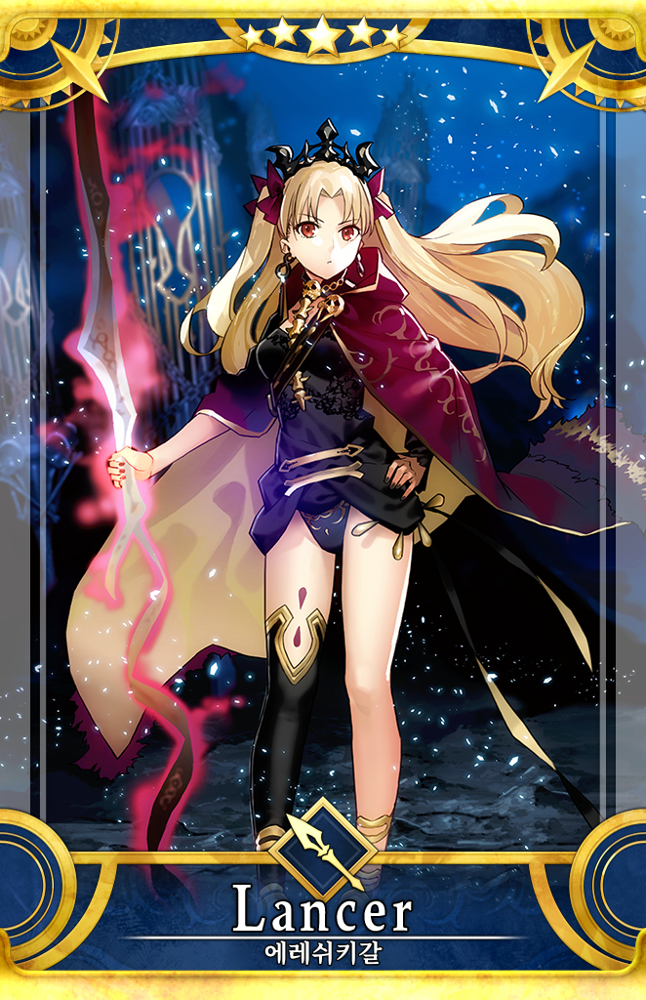
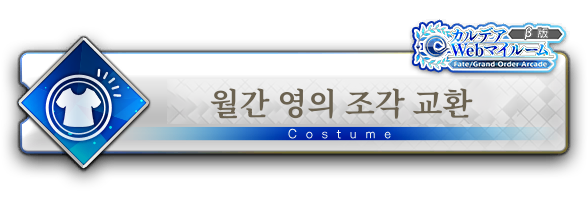
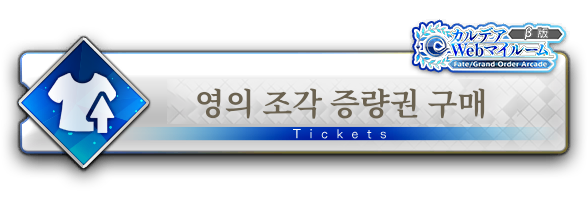
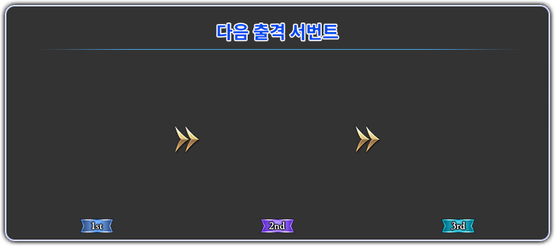

# FGO Arcade 한국어 패치

> **r004 수정본 · 기본 한국어 선택 및 일반 실행 연결 완료**
> 사용자가 수정본의 한글 화면과 게임 실행을 확인했습니다. [r004 배포본 받기](https://github.com/HowCanUDoThatToMe/FGOAC-KO/releases/tag/v1.0.0-r004)에서 설치 파일과 최신 검사 기록을 받을 수 있습니다. 설치기 소스와 MIT 적용 범위도 함께 공개했습니다.

Fate/Grand Order Arcade의 텍스트와 화면 속 글자를 한국어로 옮기는 비공식 팬 프로젝트입니다. 메뉴와 전투 안내, 카드 이미지, 서버에서 전달되는 표시 문구 등 서로 다른 형태의 자료를 수정하고, 해당 화면에 연결되도록 적용했습니다.

**이 프로젝트는 철저히 비상업적·비영리로 운영합니다. 패치와 관련한 판매 수익, 광고 수익, 유료 서비스 대가, 후원금, 기부금 등 어떤 형태의 금전적 이익도 받지 않습니다. 유료 배포나 모금도 하지 않습니다.**

**공유 대상은 한국어 패치와 설치에 필요한 구성요소뿐입니다. 게임 본체, 원본 게임 실행 파일, 원본 또는 완성된 FARC 전체, 세이브와 개인 설정은 배포하지 않습니다.** 지원되는 게임 파일을 정당한 권한으로 이용할 수 있는 환경이 별도로 필요합니다. 이 프로젝트는 게임 본체의 입수 경로를 제공하지 않습니다.

## 번역 이미지 미리보기

이번 작업에서 한국어로 번역·편집한 이미지 중 일부입니다. **실제 플레이 화면 캡처가 아닌, 게임 화면을 구성하는 개별 이미지 예시**입니다. 사용자 제공 스크린샷이나 직접 제작해 전달한 번역 이미지는 이 미리보기에 포함하지 않았습니다. 이미지를 누르면 원래 크기로 볼 수 있습니다.

| 서번트 카드 · 에레쉬키갈 | 보구 카드 · 마슈 | 보구 카드 · 카르나 |
| :---: | :---: | :---: |
|  |  |  |

서번트 카드는 한국어 이름 표기 예시입니다. 보구 카드 두 장은 **번역한 보구명과 원작 카드 부품을 조합해 작업 당시 만든 배치 참고 이미지**이며, 실제 게임에서의 배치·효과와 차이가 있을 수 있습니다.

| 상점 · 월간 영의 조각 교환 | 상점 · 영의 조각 증량권 구매 |
| :---: | :---: |
|  |  |

**전투 · 마신주 출현 안내**

**전투 · 다음 출격 서번트 패널**

개별 이미지의 투명 영역에는 게임 실행 중 배경·캐릭터·상태 정보가 합성됩니다. 전체 번역 범위와 실제 화면 검수 범위는 아래 안내를 확인해 주세요. 원작 이미지의 권리는 각 권리자에게 있습니다.

## 무엇이 바뀌나요?

- 게임의 번역 텍스트, 일부 실행 코드·서버 표시 문구와 한글 글꼴을 적용합니다.
- 버튼·메뉴·전투 안내처럼 이미지에 들어 있는 글자를 한국어로 보완합니다. 같은 버튼의 선택·비선택 등 여러 상태도 각각 연결합니다.
- 사용자가 직접 준비하고 승인한 개념예장 이미지와 기존 서번트 카드 수정 결과를 반영합니다.
- 최근 상점의 두 메뉴 표기와 성별 변경 제목·남성 버튼을 보완했습니다.
- 설치할 게임의 파일 상태와 패치 자료를 검사하고, 별도 한국어 리소스를 구성합니다. 일부 서버 보조 파일과 언어 설정도 함께 관리합니다.

**이 패치는 AI 도구인 OpenAI Codex를 사용해 제작했습니다.** 번역·코드 작성·자료 통합·검증 보조·문서 작성에 Codex를 활용했으며, 일부 이미지 작업에는 AI 이미지 생성 도구도 사용했습니다. 사용자가 직접 준비한 이미지와 직접 확인한 플레이 결과도 함께 반영했습니다. 모든 문장·이미지·기능을 사람이 전수 검수했다는 뜻은 아니며, AI가 만든 결과에는 오역이나 오류가 남아 있을 수 있습니다.

**[PhotoCraft](https://github.com/storytold/photocraft)** — 이미지 편집·크기 조정·투명도 확인·저장 및 PNG 내보내기에 사용한 오픈소스 도구입니다. 작업 기록에서 v0.15.1 사용을 확인했습니다. ArtCraft Team 및 PhotoCraft contributors의 프로젝트이며, 해당 버전은 [MIT](https://github.com/storytold/photocraft/blob/v0.15.1/LICENSE-MIT) 또는 [Apache-2.0](https://github.com/storytold/photocraft/blob/v0.15.1/LICENSE-APACHE) 라이선스를 선택할 수 있습니다. 여기서는 제작 도구 사용 사실을 밝히며 PhotoCraft 프로그램 자체를 패치에 동봉하지 않습니다.

## 지원 환경과 검수 범위

| 항목 | 현재 기준 |
| --- | --- |
| 운영체제 | Windows 64비트. 모든 Windows 세부 버전의 호환성을 보증하지 않음 |
| 게임 환경 | 제작 시 확인한 Cloud23333 업데이트 1.10 적용 환경, 내부 게임 버전 11.51 |
| 파일 호환성 | 기준 App 파일 6,302개와 서버 기준 파일을 검사. 같은 버전 표기라도 파일이 다르면 설치 거부 가능 |
| 번역 기준 | 개발판 0.4.0과 2026-10-25 상점·성별 화면 보완 결과 |
| 실제 플레이 | 0.4.0의 맵·전투 플레이 확인에 이어, 2026-10-26 사용자가 r004 수정본의 한글 화면과 게임 실행이 정상임을 확인 |
| 별도 확인 대상 | 모든 UI 상태의 전수 검수, 다른 PC·다른 원본 구성의 호환성 |
| 알려진 제한 | 일부 부가 UI와 장식용 이벤트·스테이지 제목 이미지 등에 일본어가 남아 있음 |

기준 환경에는 영문 런처 자료도 함께 있었습니다. 모든 순정 1.10 배포본, 다른 패치와의 조합, Linux·Steam Deck, 공식 온라인 서비스에서의 작동을 보증하지 않습니다. 기존 개발용 패치 상태의 자동 이전은 지원 대상으로 확정되지 않았습니다.

아래 수치는 **해당 작업 범위의 적용 기록**이며 게임 전체의 번역률이 아닙니다. 이미지 원본과 재사용 대상·상태 수를 합산하지 않습니다.

| 작업 | 기록상 적용 범위 |
| --- | --- |
| 0.4.0 일반 이미지 작업 범위 | 기본 이미지 973개 / 연결 대상 1,185개 |
| 사용자가 승인한 개념예장 이미지 | 원본 1,166개 / 연결 대상 2,340개. 별도의 새 전수 이미지 검수를 뜻하지 않음 |
| 별도 서번트 카드 선 잔여 수정 | 기본 이미지 40개 / 카드 ID 72개 |
| 이후 상점·성별 화면 보완 | 화면 요소 4개 / 상태 이미지 10개 |

## 받기와 설치

> **[r004 수정본 다운로드](https://github.com/HowCanUDoThatToMe/FGOAC-KO/releases/tag/v1.0.0-r004)** — 릴리스 페이지의 Assets에서 ZIP 두 개를 모두 받아 주세요. 두 ZIP은 각각 열리는 일반 압축파일이며, 최종 묶음은 약 4.10GB입니다. [SHA-256 목록](docs/SHA256SUMS_v1.0.0.txt)은 MIT 고지를 동봉한 r004 최종 묶음의 기록입니다.

1. 배포 페이지의 Assets에서 `FGOAC-Korean-Offline-v1.0.0-1of2.zip`과 `FGOAC-Korean-Offline-v1.0.0-2of2.zip`을 **둘 다** 받습니다. `Source code` 압축 파일은 사용자 설치용 묶음이 아닙니다.
2. 두 ZIP을 같은 위치에 압축 해제합니다. 하나의 `FGOAC-Korean-Offline-v1.0.0` 폴더 안에 `engine`, `payload`, `Start-KoreanPatch.cmd`가 함께 있어야 합니다. 이전 버전 폴더에 섞어 풀지 마세요.
3. 플랫폼·게임·로컬 서버를 완전히 종료합니다. 세이브·개인 설정은 별도로 백업해 주세요. 압축 해제에 약 4.1GB가 별도로 필요하며 게임 드라이브에는 설치 전 최소 6GB의 여유 공간을 준비합니다. 반복 업데이트·제거 시 복구 기록 보관으로 더 필요할 수 있습니다.
4. 압축을 푼 폴더의 `Start-KoreanPatch.cmd`를 실행하고 **자료 검사**를 누릅니다. Python 실행 환경은 묶음에 포함하는 구성입니다.
5. **게임 폴더 선택**으로 `App`과 `Server`가 함께 있는 게임 최상위 폴더를 선택합니다. `App` 폴더 자체를 선택하지 마세요.
6. **설치 / 업데이트**를 누르고 결과를 확인합니다. 파일이 맞지 않거나 누락되면 중단하며, 빠진 자료를 인터넷에서 자동으로 받지 않습니다.
7. 설치 완료 후 설치창을 닫고, 기존 로컬 플랫폼의 **언어 → 게임 언어**를 **한국어**로 둡니다. **런처 언어**도 한국어로 선택할 수 있습니다. 이후 **서버 시작 → 게임 시작** 순서로 실행합니다. 설치가 게임을 자동 실행하지는 않습니다.

**설치는 처음 한 번만 하면 됩니다.** 수정본(r004)은 기본 **한국어** 선택을 이번 한글패치에 연결합니다. 별도의 `ko-fgoac` 항목을 찾거나 매번 패치 설치창을 열 필요가 없습니다. 이전 r002·r003 시험본을 설치했다면 새 설치기의 **설치 / 업데이트**를 한 번 실행해야 합니다. 같은 번역 자료를 쓰는 실행 연결 수정은 번역 이미지 전체를 다시 복사하지 않습니다. 설치·업데이트·제거 전에는 플랫폼·게임·서버를 모두 종료하세요. 실행 스크립트 원본은 백업하며 패치 제거 시 복원합니다.

전체 묶음을 받은 뒤에는 설치 과정에서 인터넷 연결이 필요하지 않습니다. 설치기의 자료 다운로드·업데이트 확인·자동 업로드는 제공하지 않는 방향입니다. 새 버전도 전체 배포 자료를 다시 받아 설치합니다. 이 설명은 **패치 설치기**에 관한 것으로 게임·서버·Discord의 모든 통신까지 없다는 뜻은 아닙니다.

기존 다운로드형 `FGOAC-Korean-Setup.exe`와 온라인 시작 스크립트는 새 묶음에서 제외합니다. 다만 Python 등 동봉 실행 환경은 실행 파일을 포함하므로 “EXE가 전혀 없는 배포”라고 설명하지 않습니다.

## 상태 확인·제거·중단 복구

설치에 사용한 묶음의 `Start-KoreanPatch.cmd`를 다시 실행해 **상태 확인**, **제거**, **중단 복구**를 선택하는 구성입니다. 설치 폴더의 `.fgoac-korean`에는 관리 도구와 복구 기록이 보관됩니다. 제거·복구 전에 이를 임의로 삭제하지 마세요.

설치기가 관리하던 파일을 다른 도구로 변경하면 보호를 위해 작업을 거부할 수 있습니다. 오류 메시지를 기록하고 제보해 주세요. 강제로 덮어쓰거나 백업 폴더를 지우는 방법을 기본 해결책으로 안내하지 않습니다. 설치·복구 검증 범위는 아래 검사 기록을 확인해 주세요.

## 백신 경고가 나오면

실행을 멈추고 백신 이름, 판정명, 패치 버전, 대상 파일명과 SHA-256을 확인해 주세요. 백신 끄기, 게임 폴더 전체 검사 제외, 경고 무시를 설치 절차로 요구하지 않습니다.

이전 다운로드형 `FGOAC-Korean-Setup.exe`는 2026-10-25에 7/68 탐지가 보고됐으며 원인은 확정되지 않았습니다. 해당 파일은 새 묶음에서 제외합니다. 다른 파일의 과거 0/57 결과나 다른 프로젝트 사례는 새 묶음 전체의 안전성을 증명하지 않습니다. 파일 해시 확인도 악성코드 검사나 제작자 인증을 대신하지 않습니다.

### 한국어 선택 연결 수정본(r004)의 확인 상태

r004는 로컬 플랫폼의 기본 **한국어** 선택으로 게임 리소스와 서버 표시 문구를 함께 적용하도록 수정했습니다. 설치·제거·중단 복구 등 검사 23개와 실제 실행 스크립트·서버의 다섯 언어 분기 검사를 통과했습니다. 실제 시험 폴더에 적용한 뒤 번역 4,364개와 개인 설정 보존을 확인했고, 2026-10-26 사용자가 한글 화면과 게임 실행이 정상임을 확인했습니다. 2026-10-26 00:15 KST에 MIT 고지를 동봉한 r004 최종 후보 폴더를 Defender로 검사해 **위협 없음, 종료 코드 0**을 확인했습니다. **변경된 세 설치기 파일의 VirusTotal 보고서도 확인했으며, 악성 탐지는 0건입니다. 시간 초과·미지원·실패가 있어 아래 파일별 결과와 함께 확인해 주세요.** 최종 ZIP 1,094개 항목이 후보와 일치했고, 개인정보 패턴 검사 1,755개 항목에서 지정한 개인 경로·자격증명 패턴이 발견되지 않았습니다. [r004 검사 기록](docs/SECURITY_CHECK_R004_20261026.json)에서 파일 해시와 검사 범위를 확인해 주세요.

### r004 수정 파일의 VirusTotal 추가 확인

2026-10-26에 출시 후 추가로 조회한 결과입니다. 세 보고서의 SHA-256은 배포한 r004의 해당 파일과 일치합니다. 출시 당시의 [검사 기록](docs/SECURITY_CHECK_R004_20261026.json)은 그대로 보존하며, 후속 결과는 [VirusTotal 추가 확인 기록](docs/VIRUSTOTAL_R004_20261026.json)에 별도로 남겼습니다.

| 파일·보고서 | 악성 탐지 / 표시된 엔진 수 | 마지막 검사 시각(KST) |
| --- | --- | --- |
| [`engine.py`](https://www.virustotal.com/gui/file/7a1e56ebdd0f546f2ff6fef37a9bd397b4d61596145689dd69440b13a899ecb5) | **0/61** | 2026-10-26 00:34:16 |
| [`native_label_support.py`](https://www.virustotal.com/gui/file/964e63a04a1ab4591f414c53359a388c60e78751003afaf89a87b6a08edfd015) | **0/61** | 2026-10-26 00:29:43 |
| [`platform_launch.py`](https://www.virustotal.com/gui/file/037aadb57c00fbe1488cf21f13c8c740dfb269b91b480efe23bed9bf43fdbe7e) | **0/61** | 2026-10-26 00:31:24 |

최신 보고서에서 세 파일 모두 각각 미탐지 61개, 시간 초과 1개(Confirmed timeout), 파일 형식 미지원 13개가 표시됐습니다. **시간 초과·미지원을 미탐지로 계산하지 않습니다.** 이 표는 해당 세 파일의 확인 시점 결과이며 ZIP 전체의 VirusTotal 검사나 안전성 보증을 뜻하지 않습니다.

### 이전 실행 방식 수정본(r003)의 검사 기록

r003은 설치 후 기존 로컬 플랫폼에서 실행하도록 연결한 이전 시험본입니다. 설치·제거·중단 복구 및 실행 검사 22개와 실행 스크립트의 구문·언어 분기 검사를 통과했고, 후보 폴더의 Defender 검사는 위협 없음으로 끝났습니다. 이후 플랫폼에서 패치 언어 항목을 선택할 수 없는 문제가 확인되어 r004에서 보완했습니다. **아래 r002의 VirusTotal 결과를 r003·r004 수정 파일에 적용할 수 없습니다.**

### r002 배포본의 검사 기록

r002는 제작 PC의 실제 경로를 배포 코드에서 제거하고, 보호 경로를 해시로 대조하도록 바꿨습니다. 고지·라이선스를 동봉하고 설치 후에도 보존하며, 한글 게임 실행 버튼과 안내를 보완했습니다.

2026-10-25 22:42 KST에 r002 폴더를 Microsoft Defender로 다시 검사하여 **위협 없음, 종료 코드 0**을 확인했습니다(약 21.5초). 압축파일 전체 내용 1,091개가 후보 파일과 일치했고, 정적 개인정보 검사에서 1,752개 검사 항목에 지정한 개인 경로·계정명·자격증명 패턴이 발견되지 않았습니다. 패턴 검사만으로 모든 개인정보나 실행 중 통신을 검증한 것은 아닙니다.

DLL·Python 실행 파일 두 개는 아래 기존 VirusTotal 기록과 해시가 같습니다. 수정된 두 파일은 사용자가 별도로 제출했고, 배포본의 해시와 일치하는 다음 결과를 확인했습니다.

| r002 수정 파일·보고서 | 악성 탐지 / 표시된 엔진 수 | 마지막 검사 시각(KST) |
| --- | --- | --- |
| [`engine.py`](https://www.virustotal.com/gui/file/1f9ab7169a3e2890d34ca766146de5583c5b1e3416c755dd8d66891bc8a21dca) | **0/61** | 2026-10-25 22:53:49 |
| [`offline_ui.py`](https://www.virustotal.com/gui/file/8c1e1daf200da58ca98a9b46fc18016853ea244e4490e4773aeb152294b30c49) | **0/61** | 2026-10-25 22:52:36 |

정확한 파일 해시와 검증 범위는 [r002 검사 기록](docs/SECURITY_CHECK_R002_20261025.json)에 있습니다. 일부 엔진의 시간 초과·미지원은 탐지 없음과 구분합니다.

실제 게임 파일의 별도 시험용 복사본에서 **신규 설치·동일 버전 재실행·중단 복구·상태 확인·제거**를 통과했습니다. 설치 결과 4,364개와 서버 보조 파일 3개가 승인 해시와 일치했고, 제거 후 설정 원복 및 라이선스 고지 보존도 확인했습니다. 이 시험에서 게임을 실행하거나 화면을 확인하지는 않았습니다.

### 이전 r001의 파일별 검사 기록

2026-10-25에 **오프라인 r001 후보 폴더**와 **동일한 패치 DLL**을 Microsoft Defender로 검사했습니다. 두 검사 모두 **위협 없음(`found no threats`), 정상 종료 코드 0**을 반환했습니다.

| 검사 대상 | 결과 | 시간을 기록한 검사 |
| --- | --- | --- |
| 오프라인 r001 후보 폴더 전체 지정 | 위협 발견 안 됨 | 22:17 KST, 약 13.8초(확인 재검사) |
| `fgoko-labels.dll` 별도 검사 | 위협 발견 안 됨 | 22:18 KST, 약 0.5초 |

Defender 엔진은 `1.1.26090.9`, 보안 인텔리전스는 `1.461.196.0`이었습니다. 사용한 사용자 지정 검사 옵션은 파일 제외를 무시하고 압축 파일을 검사하며, 탐지 후 자동 삭제·격리는 수행하지 않습니다. [Microsoft의 옵션 설명](https://learn.microsoft.com/en-us/defender-endpoint/command-line-arguments-microsoft-defender-antivirus)

2026-10-25에 아래 네 파일의 **VirusTotal 보고서와 로컬 파일의 SHA-256 일치**도 확인했습니다. DLL과 설치 엔진은 사용자가 제출한 검사 결과이며, Python 실행 환경 두 파일은 동일 해시의 기존 보고서를 조회한 결과입니다.

| 파일·보고서 | 악성 탐지 / 표시된 엔진 수 | 보고서의 마지막 검사 시각(KST) | 확인 구분 |
| --- | --- | --- | --- |
| [`fgoko-labels.dll`](https://www.virustotal.com/gui/file/44f17bb95f75cc0f9ed0b35de52f0e84d567dd80ba6dabb714769dc0db57b04e) | **0/70** | 2026-10-25 22:24:27 | 사용자 제출 후 결과 확인 |
| [`python.exe`](https://www.virustotal.com/gui/file/3cce33d75d6fdae4e004d0bdf149320b3147482a9caf370079dcb9c191a1b260) | **0/71** | 2026-10-10 04:26:36 | 동일 해시의 기존 보고서 조회 |
| [`python310.dll`](https://www.virustotal.com/gui/file/14b06796f288bc6599e458fb23a944ab0c843e9868058f02a91d4606533505ed) | **0/71** | 2026-10-19 19:11:20 | 동일 해시의 기존 보고서 조회 |
| [`engine.py`](https://www.virustotal.com/gui/file/ddffa3b7474e6e70cc27f2e88b002882b7c91b69d3697222cbf0951e7ac00b97) | **0/61** | 2026-10-25 22:25:06 | 사용자 제출 후 결과 확인 |

VirusTotal 수치는 확인 당시의 표시값이며 이후 갱신될 수 있습니다. 일부 엔진은 파일 형식을 지원하지 않거나 시간 초과로 검사를 마치지 못했습니다. 위 표는 네 파일에 관한 결과이며 배포 ZIP 전체를 VirusTotal로 검사했다는 뜻은 아닙니다.

**이 결과는 안전 보증이나 개인정보 유출이 없다는 증명을 뜻하지 않습니다.** Defender 검사 시간만으로 검사 깊이를 판정하지 않으며, 내부 파일별 실제 검사 수는 출력되지 않았습니다. 차분을 적용한 게임 전체의 실행·통신 검증도 별도입니다. 후보가 바뀌면 변경된 파일을 다시 검사해야 합니다. 검사 대상 ZIP·파일의 해시와 범위는 [검사 기록](docs/SECURITY_CHECK_R001_20261025.json)에 남겼습니다.

## 📮 오류 제보 및 개선 건의

[**디스코드 제보 봇 설치하기**](https://discord.com/oauth2/authorize?client_id=1562153790201663578)

번역 오류·이미지 출력 문제·실행 오류나 개선 의견은 디스코드 제보 봇으로 보내 주세요. 별도 서버에 가입하거나 제작자에게 직접 DM을 보낼 필요는 없습니다. 설치기가 제보 자료를 자동 전송하지 않습니다.

1. 위 링크에서 디스코드에 로그인한 뒤 **내 계정에 추가(Add to My Apps)**를 선택하고 권한 요청을 승인합니다.
2. 디스코드에서 `/제보`를 실행하고 **제보 유형·제보 내용·패치 버전**을 입력합니다. 필요하면 `사진1`~`사진3`을 첨부한 뒤 제출합니다. 접수번호가 발급되고 내용은 한글패치 제작자에게 전달됩니다.

| 명령어 | 기능 |
| --- | --- |
| `/제보` | 오류 제보 및 개선 의견 제출 |
| `/내제보` | 본인의 제보 내역·처리 상태·제작자 답변 확인 |
| `/안내` | 봇 이용 방법 확인 |

사진은 **최대 3장**, **PNG·JPG·GIF·WebP**, **장당 최대 8 MiB·전체 최대 20 MiB**까지 첨부할 수 있습니다. **봇에게 일반 DM으로 메시지나 사진만 보내면 정식 제보로 접수되지 않으므로 `/제보`를 이용해 주세요.** 동일한 제보의 반복 제출은 삼가 주세요. 스팸 방지를 위한 제출 횟수 제한이 있습니다.

제보할 때 아래 내용을 함께 준비하면 문제 확인에 도움이 됩니다.

- 패치 버전, 설치한 게임 환경, Windows 버전
- 문제 종류: 오역·오타 / 이미지·글자 잘림 / 설치·업데이트·제거 오류
- 해당 화면과 표시 문구, 재현 순서, 기대한 결과와 실제 결과
- 필요한 경우 오류 메시지 또는 개인정보를 가린 화면. 백신 문제라면 파일명·SHA-256·백신 판정명

게임 전체, 원본 실행 파일·FARC, 세이브, 계정·카드 번호, 개인 설정, 토큰·비밀번호는 보내지 마세요. 스크린샷의 개인정보를 가리고, 원본 로그를 통째로 올리지 마세요. 제보 검토·수정 일정과 개별 답변을 보장하지 않습니다.

## 저작권·비공식 프로젝트·책임 범위

Fate/Grand Order Arcade 및 관련 명칭·캐릭터·음악·이미지·원문과 게임 프로그램의 권리는 각 권리자에게 있습니다. 이 패치는 공식 한국어판이 아니며, 원작의 개발사·퍼블리셔·권리자와 제휴하거나 그들의 승인·후원을 받은 프로젝트로 표시하지 않습니다.

패치는 한국어 이용 편의를 위한 비상업적·비영리 팬 작업입니다. 제작자는 판매·광고·유료 서비스·후원·기부를 포함한 어떠한 금전적 이익도 받지 않습니다. 무료·비영리 운영이나 차분 배포가 권리자의 이용허락을 대신하거나 저작권 문제를 자동으로 해소하는 것은 아닙니다.

이 자료는 제공된 상태로 제공하며, 오류 없음·모든 환경의 호환성·지속적인 업데이트·특정 목적 적합성을 보증하지 않습니다. 사용 전 지원 조건을 확인하고 필요한 데이터를 백업해 주세요. 적용 법령상 허용되는 범위에서 이용·설치로 생기는 문제에 대한 책임이 제한될 수 있으나, 이 안내가 법적으로 배제할 수 없는 책임을 없애거나 적법성을 보증하지는 않습니다.

**권리자 또는 그 대리인으로부터 DMCA 통지 등 저작권 침해 신고나 게시 중단 요청을 받으면, 해당 자료를 내리고 배포를 중단하겠습니다.** 이 방침은 권리자의 권리를 존중하기 위한 운영 원칙이며, 이용허락이나 적법성·면책을 보증하는 문구가 아닙니다.

제3자 도구·글꼴·런타임에는 각각의 라이선스가 적용됩니다. 프로젝트의 비영리 운영 원칙이 해당 라이선스의 권리를 변경하지 않습니다. 전체 게임 자료에 하나의 오픈소스 라이선스를 적용하지 않습니다.

## 설치기 코드와 MIT 라이선스

직접 만든 [설치기 소스](installer/) 중 [명시한 9개 파일](installer/LICENSE_SCOPE.md)에 [MIT License](installer/LICENSE)를 적용했습니다. 해당 코드의 이용·수정·재배포와 상업적 재사용을 허용하며, 저작권 표시와 허락 고지를 유지해야 합니다. 제작자가 수익·후원·기부를 받지 않는다는 운영 방침은 MIT에 별도의 상업 이용 금지를 추가하는 뜻이 아닙니다.

게임·번역·이미지·차분 자료와 외부 구성품까지 MIT로 허락하는 것은 아닙니다. [전체 라이선스 구분](LICENSE.md)과 [제3자 고지](docs/THIRD_PARTY_NOTICES_KO.md)를 확인해 주세요. 같은 MIT 전문과 적용 범위는 배포 ZIP의 `engine/licenses`에도 들어 있습니다.

## 크레딧

- 원작 제작진과 각 저작권자: 게임과 원작 콘텐츠.
- 한국어 패치 제작자와 참여자: 번역, 이미지 수정·통합, 설치 도구와 검증. 공개 표기명은 최종 확인합니다.
- 직접 개념예장 이미지를 준비하고 플레이를 확인한 사용자 및 제보 참여자.
- Cloud23333: 로컬 플랫폼·현지화 도구 관련 선행 작업. 언급은 재배포 허락이나 공식 제휴를 뜻하지 않습니다.
- [FGOAC scooby 기여자](https://github.com/githubuser420x/FGOAC-scooby): FARC 형식 구현 등 참고·파생 도구 코드. 해당 코드의 MIT 고지는 별도로 유지합니다.
- Noto·Adobe·Google 및 해당 글꼴 기여자: Noto 기반 한글 글꼴과 보완 글리프. SIL OFL 1.1 적용.
- Python Software Foundation, Tcl/Tk, Zig, MinGW-w64 및 실제 포함 구성요소의 기여자.

최종 동봉 고지 목록은 [제3자 고지 초안](docs/THIRD_PARTY_NOTICES_KO.md), 권리 확인 상태는 [내부 검토표](docs/PREPUBLICATION_CHECKLIST_KO.md)를 참조합니다. 확인표는 공개 허락이나 법률 의견서가 아닙니다.

[릴리스 안내](docs/RELEASE_NOTES_R004_KO.md) · [제보 안내](docs/REPORTING_KO.md)
